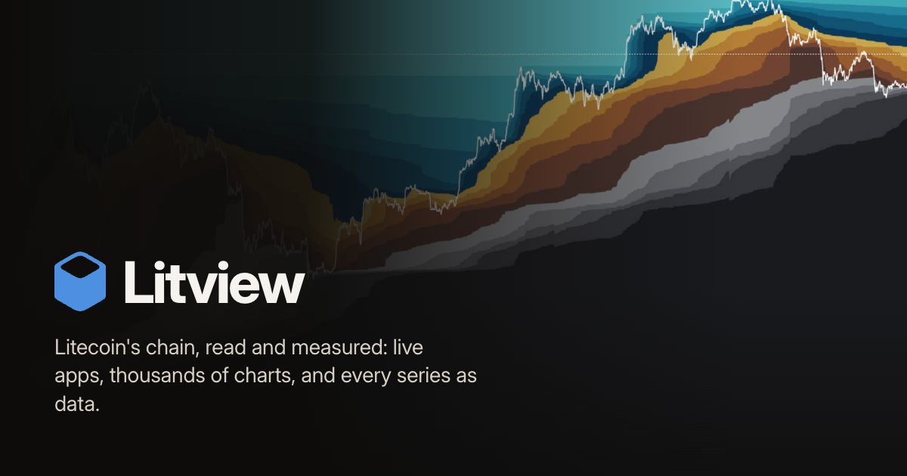

<a href="https://litview.space"></a>

# Litview and the Litecoin Research Kit

Litview turns a Litecoin Core node into a local Litecoin data platform for chain
exploration, mempool data and on-chain research, MWEB included. The free hosted
instance is [litview.space](https://litview.space).

- **Litecoin Research Kit (LRK):** Rust crates for reading Litecoin Core data:
  RPC, block files in chain order with their MWEB extension blocks, the live
  mempool, Litecoin's types and typed storage.
- **Litview:** the self-hostable application built from them: an indexer and
  analytics plugins, a query layer, a REST API, an MCP endpoint, the apps and
  Studio, and generated clients.

It is a Litecoin fork of [Bitview and the Bitcoin Research Kit](https://github.com/bitcoinresearchkit/mono),
kept in step with upstream.

## What Litecoin changes

- **MWEB:** the extension block is decoded with each block. Its supply, peg-ins,
  peg-outs, kernels and fees are series of their own (`mweb_*`), and MWEB coins
  stay out of the transparent supply, cohorts and address balances.
- **HogEx:** the last transaction of every block since MWEB's activation (height
  2,265,984). Its fee counts in block fees; it stays out of transaction counts,
  volume and fee-rate statistics.
- **Price:** exchange daily closes before height 2,200,000 (January 2022), the
  on-chain oracle after.
- **The chain itself:** genesis on 7 October 2011, 2.5-minute blocks,
  840,000-block halvings, litoshis and Ł.

## Use Litview

The hosted apps, API and MCP endpoint need no account:

- [Litview](https://litview.space), its apps and Studio
- [Interactive API](https://litview.space/api) and [OpenAPI](https://litview.space/openapi.json)
- MCP endpoint: `https://mcp.litview.space/`
- [Developer guide](https://litview.space/dev/) and [the crates](https://litview.space/brk/)

```bash
curl https://litview.space/api/series/count
curl 'https://litview.space/api/series/search?q=mweb'
curl 'https://litview.space/api/series/mweb_supply/day1?start=-7'
```

## Self-host

```bash
git clone https://github.com/LitecoinResearchKit/lrk && cd lrk
RUSTFLAGS="-C target-cpu=native" cargo install --locked --path crates/bitviewd --features litecoin --profile release-ltc
bitviewd
```

You need Linux or macOS, a mainnet Litecoin Core node with RPC enabled and
complete block files from genesis, 16 GB of memory or more, and about 95 GiB of
disk on top of Litecoin Core's. A first index from block 0 takes about an hour
and a quarter on a 64 GB Mac with a fast SSD.

`bitviewd` reads Litecoin Core's default data directory and RPC port (9332)
unless told otherwise, and serves the apps and API at
[localhost:3110](http://localhost:3110), to this machine only unless
`serverbind` says otherwise. See the [`bitviewd` guide](../crates/bitviewd) for
configuration.

## Develop

Everything Litecoin-specific sits behind the `litecoin` Cargo feature, so the
Bitcoin build still compiles and upstream merges stay small. Names shown to
people (Litview, LTC, litoshis, the blue) are rewritten from upstream's at build
time by [`brk_relabel`](../crates/brk_relabel).

```bash
cargo check -p bitviewd --features litecoin
cargo check --workspace
cargo bindgen --features litecoin   # regenerates the clients as Litecoin
```

Upstream's own documentation is in [`docs`](../docs): the
[architecture](../docs/ARCHITECTURE.md) and the [changelog](../docs/CHANGELOG.md).

## Support

If Litview is useful to you, you can support its development at
[indigodevlab.com/fund](https://indigodevlab.com/fund): in Litecoin, public or
private through MWEB, or with X Money.

## Credits and license

Bitview and the Bitcoin Research Kit are by [nym21](https://x.com/_nym21_). This
fork is maintained by the [Litecoin Research Kit](https://github.com/LitecoinResearchKit).
[Issues](https://github.com/LitecoinResearchKit/lrk/issues) are welcome.

[MIT](../LICENSE)
